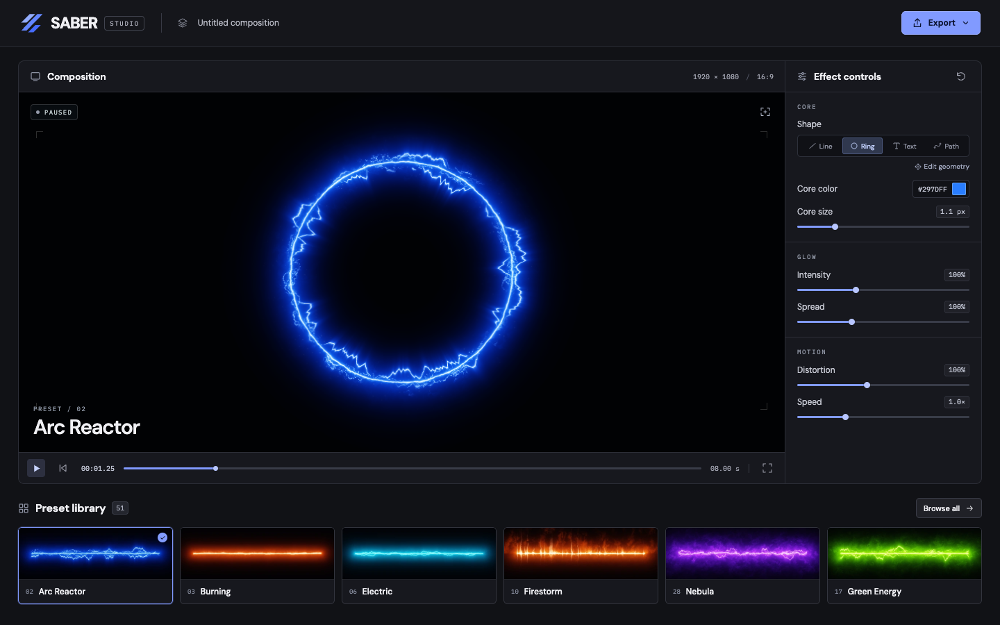
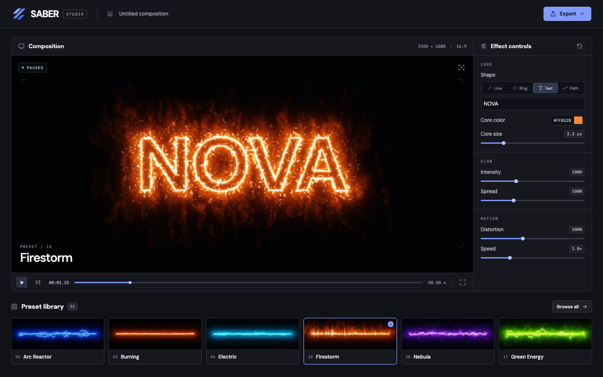
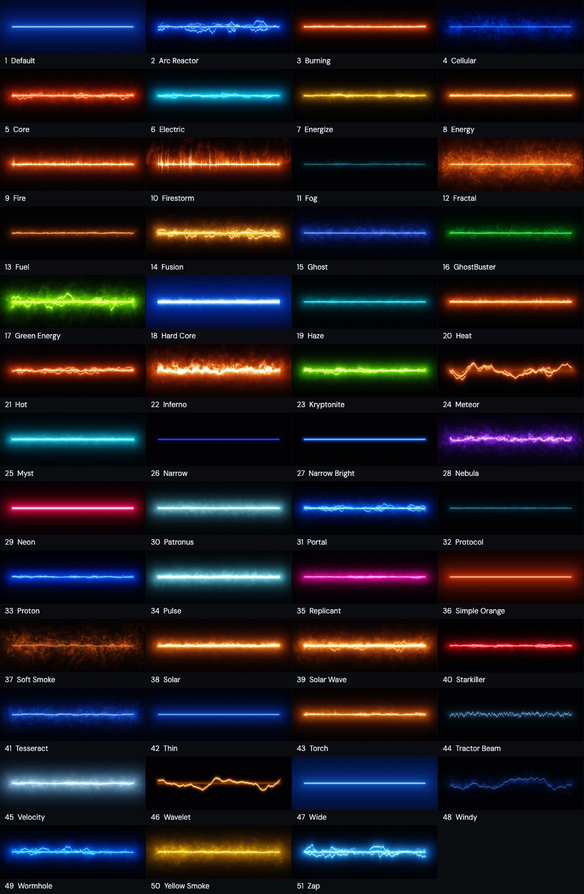

# Saber Studio

An offline WebGL 2 editor for animated energy effects, inspired by Video Copilot’s Saber for After Effects. Wrap an electric arc around a ring, trace lettering with fire, or draw a path and watch the glow follow your stroke.



## Open the editor

Download the repository ZIP from **Code → Download ZIP**, extract it, and open **index.html** in a browser with WebGL 2 and graphics acceleration enabled. The editor, fonts and preset thumbnails are bundled in that file. It works offline.

## Make a title burn

1. Select **Firestorm** in the preset strip.
2. In **Effect controls → Shape**, choose **Text** and enter your title.
3. Adjust **Core size** to set the weight of the lettering. Increase **Spread** for a wider halo, or raise **Distortion** to break up the outline.
4. Press **Space** to pause, then scrub to a frame you like. Choose **Export** to save a transparent PNG, or select **Video · One loop** to record the animation.



## Explore the presets

**Browse all** opens 51 looks with name search and family filters. Switch to **Line** to compare the beams on the same geometry. **Edit geometry** moves line endpoints or changes a ring’s center and radius. In **Path** mode, **Draw path** lets you sketch directly on the canvas.

<details>
<summary>View all 51 rendered presets</summary>



</details>

## Export

| Output | Options |
| --- | --- |
| PNG frame | 720p, 1080p or 4K, with an optional transparent background |
| Video loop | One full cycle at the selected speed. The default is eight seconds. Keep the tab visible while recording. The browser chooses a supported WebM or MP4 encoder. |

## Work on the renderer

The editable sources are in [src](src). Rebuild the checked-in editor after making changes:

```sh
python3 build.py
```

- [render.js](src/render.js) contains the shaders for the core, filaments and vapor. A second pass samples the rendered light at several scales to build bloom around bright details.
- [masks.js](src/masks.js) converts text outlines and drawn paths into distance fields so the same effects can follow different shapes.
- [presets.js](src/presets.js) defines the effect families and the parameters for each look.
- [app.js](src/app.js) connects the preview, geometry controls, playback and export.

Saber Studio is an independent browser recreation. Bundled font licenses are in [font-licenses.txt](src/font-licenses.txt).
